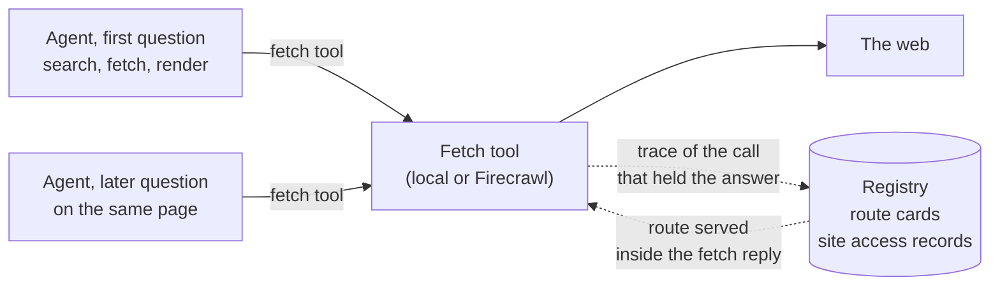

# Agent Breadcrumbs

**Can one AI agent's trip through a website make the next agent's trip cheaper?**

When an agent answers a question from the web, it searches, fetches wrong pages, reads whole pages for one fact and fights JavaScript-only sites. A **breadcrumb** records the route that worked: which page, which section, which API or raw-source URL. The next agent that asks about that site starts from that route instead of from zero.

This repo is the research behind that idea: a draft record format, an experiment harness on Claude Code, and a log of about 40 measured iterations. It is not a product yet. The experiments are deciding whether there should be one.

## Where it stands (2026-11-17)

**Phase 2 of 5: the fair test.** The registry gets built only if breadcrumbs save money on questions people actually ask. So far:

| Where | What a breadcrumb saves | Verdict |
| --- | --- | --- |
| Hard-access sites, multi-fetch tasks (APIs, raw sources, JS-heavy pages) | **−21% to −41%** on a related question, in dollars | Pays, and is right 179 of 180 times |
| 30 popular reference pages, all kinds | **−13% to −15%** over 10 reuses | Pays, below the plan's 30% bar |
| One-fetch pages and library docs | **+7% to +18%** (the fixed cost of the tool text) | Loses |
| Firecrawl, against a stock `firecrawl-mcp` agent | About **half a task** when a card is hit; 1 hit in 9 tasks | Break-even overall |
| **Real Stack Overflow questions** on GitHub Actions and MDN docs | A useful hit **~1 question in 100** | **Nothing to save on popular docs** |

The last row changed the direction of the project. On 199 real questions, agents already find the right docs page, usually the right anchor, for about $0.03 a question. Cards keyed by page are rarely reached on a long-tail site like MDN, and where they are (GitHub Actions), the agent was already asking for the section the card would serve.

**Next question:** where *do* agents waste money on the web? Stock runs on real questions about long-tail, JavaScript-heavy, API-only and recently changed sites, to find the expensive runs and check whether the same waste repeats across questions on a site. A shared registry only makes sense if it does.

## What we've learned

1. **Raw HTML is the wrong unit.** Six real pages: 718,845 tokens of raw HTML, 37,517 of cleaned text, 682 of hand-written breadcrumbs. Cleaning is a code job, not an AI job. On JS-heavy sites, knowing *how* to get the data (render it, call the API) saved the most.
2. **Agents don't need to write breadcrumbs.** A route card built automatically from one run's trace saves as much on the next question as a card the agent wrote (−14% vs −15%), with no write cost. Agent writing only wins where the saving is a URL pattern (`cmdline-opts/{option}.md`) that only an agent would generalize.
3. **The lookup belongs inside fetch.** A separate "check the registry" tool call costs about +5% median, nearly all of a typical card's saving. The fetch tool now reads the registry itself.
4. **Firecrawl's `query` format already does most of what a card does.** A stock Firecrawl agent scrapes a URL it can guess and asks Firecrawl's model for the answer. Cards beat that only when they route somewhere the agent wouldn't guess.
5. **Noise is a heavy tail.** Identical cards repeat within about 4% median. Now and then a reader misses the route and wanders, and one such run moves a group result by 10 points. Two reps don't separate arms that differ by less.
6. **Task ids leak.** An agent could read a Stack Overflow answer id from its working directory, and 16 of 35 runs used it. New tasks use opaque ids.

Every result above has its setup, runs and caveats in [experiment/LOG.md](experiment/LOG.md).

## How it works now



- **Route card (L1):** for one page, the cheapest call that got its content: URL, section or offset, render or not, size. Built from traces; no agent writes it.
- **Site access record:** for one site, how to get data at all: an API, a raw-source URL pattern, "needs rendering". Written by an agent only when a fetch shows such a route.
- The record format is [docs/breadcrumb-standard.md](docs/breadcrumb-standard.md) (draft v0.2); JSON Schemas are in [experiment/schema/](experiment/schema/).

## Documents

- [experiment/LOG.md](experiment/LOG.md): every iteration, newest at the bottom. **The most current source.**
- [docs/PLAN.md](docs/PLAN.md): problem, landscape, decisions, test plan, roadmap, risks. Mirrors the shareable [plan doc](https://claude.ai/artifact/4NE5HAUh1WMnhhWoNZzNrP), last synced 2026-11-17.
- [docs/breadcrumb-standard.md](docs/breadcrumb-standard.md): draft v0.2 of the record format.
- [research/](research/): the token measurements, a library-docs probe ([report](research/knowledge-gap-probe-report.md)) and scripts for counting access failures in your own Claude Code transcripts.

## Layout

```
docs/                       plan, standard, diagrams
experiment/
  run.py                    harness: runs Claude Code headless on each task, logs cost and answers
  report.py, rescore.py     tables in tokens, uncached tokens, dollars, output and peak context
  tasks.yaml, tasks_head.yaml   hand-written tasks with answers checked at the source
  bc/                       MCP servers: fetch/render with the registry folded in, the registry,
                            a Firecrawl backend and a card wrapper around stock firecrawl-mcp
  hitrate/                  398 real Stack Overflow questions on 4 docs sites, and the hit-rate scorer
  schema/                   JSON Schemas for site records and L1 page cards
  out_<iteration>/          drivers and report scripts per iteration (run data is not committed)
research/
  measurements/             pages and token counts from 2026-10-21
  probe/                    library-docs questions for the knowledge-gap probe
  scripts/                  token counting, access-failure and concentration scripts
```

## Running it

Experiments run through Claude Code headless mode (`claude -p --output-format json`) on a Pro plan, so no API key is needed. Firecrawl backends need a `FIRECRAWL_API_KEY`.

```
cd experiment
python run.py verify                              # re-check every task's answer at its source
python run.py cold-nowrite --set hard --rep 1     # no-breadcrumb baseline
python run.py warm-related-nowrite --set hard     # related question with the cold run's registry
python run.py --help                              # all conditions, iterations and backends
```

Iteration names (`miss-0.13`, `trace-0.2`, `card-0.4`, …) are listed with what each changed at the top of the [log](experiment/LOG.md); `--iteration <name> --out out_<name>` reruns one.

To reproduce the token measurements:

```
pip install tiktoken trafilatura markdownify beautifulsoup4
python research/scripts/measure.py research/measurements/pages out/
python research/scripts/count.py research/measurements/crumbs research/measurements/pages_md
python research/scripts/formats.py
```

Token counts use OpenAI's `o200k_base` tokenizer as an approximation of Claude's; experiment results are reported in dollars, which a Pro plan meters roughly in step with ([LOG, meter-0.1](experiment/LOG.md)).

Snapshots of third-party pages under `research/measurements/` are kept only to reproduce the token counts; they belong to their owners.
