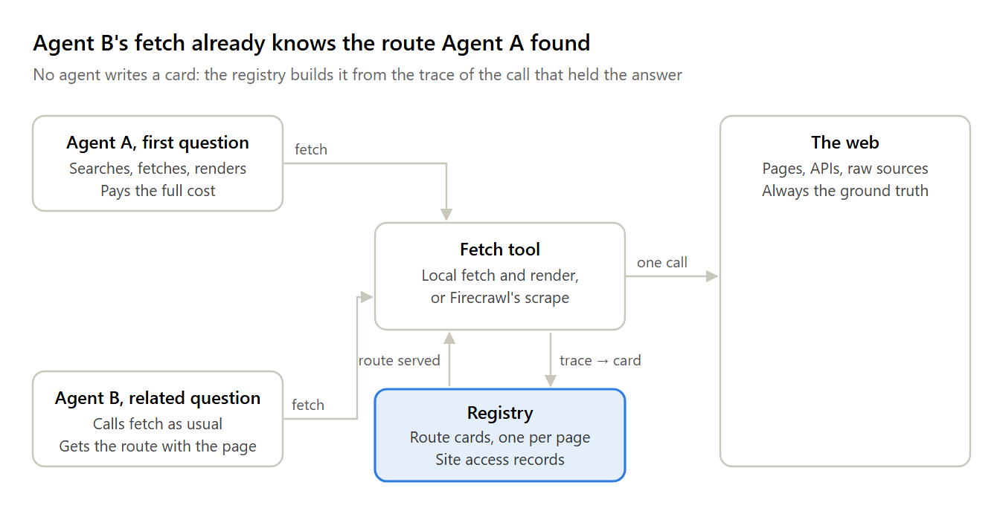

# Agent Breadcrumbs

When an AI agent reads a web page, it leaves a short, structured note (a **breadcrumb**) in a central registry, so the next agent can skip the searching, wrong turns and failed fetches.



- **Plan:** [docs/PLAN.md](docs/PLAN.md) — problem, measurements, landscape, use cases, test plan, short-term execution plan, roadmap, risks. Mirrors the shareable [plan doc](https://claude.ai/artifact/4NE5HAUh1WMnhhWoNZzNrP).
- **Standard:** [docs/breadcrumb-standard.md](docs/breadcrumb-standard.md) — draft v0.2 of the record format.

## Why

Measured on six real pages, raw HTML was 718,845 tokens, the cleaned text 37,517, and hand-written breadcrumbs 682. On JavaScript-heavy sites a plain fetch returned almost nothing; knowing *how* to get the data (render it, use the API, keep only the right fields) was the biggest saving. Details in [PLAN.md](docs/PLAN.md#problem-and-idea).

## Status

Phase 1 (standard) in progress. Next: a viability experiment comparing agents with L1 page cards + site access records against agents with no breadcrumbs, on about 24 public-web tasks. See [Short-term execution plan](docs/PLAN.md#short-term-execution-plan).

Experiments run through Claude Code headless mode (`claude -p --output-format json`) on a Pro plan; no API key needed.

## Layout

```
docs/
  PLAN.md                   full plan
  breadcrumb-standard.md    draft standard v0.2
  img/                      diagrams
research/
  measurements/             pages and token counts from 2026-10-21
    pages/, clean/            static pages: raw HTML, cleaned Markdown
    pages_md/                 sites' own .md versions (Stripe .md page, Firecrawl raw README)
    crumbs/                   hand-written sample breadcrumbs, in the informal pre-v0.2 format
                              they were measured in; not valid v0.2 records
    js_static/, js_rendered/  JavaScript-heavy pages: plain fetch vs headless Chrome
    *_clean/                  cleaned versions of the above
    formats/                  breadcrumb format comparison
  scripts/                  token-counting scripts
```

Snapshots of third-party pages under `research/measurements/` are kept only to reproduce the token counts; they belong to their owners.

## Reproducing the measurements

```
pip install tiktoken trafilatura markdownify beautifulsoup4
python research/scripts/measure.py research/measurements/pages out/
python research/scripts/count.py research/measurements/crumbs research/measurements/pages_md
python research/scripts/formats.py
```

Token counts use OpenAI's `o200k_base` tokenizer as an approximation of Claude's.

## Related

[`llmstxt-research`](../llmstxt-research) (local) studies better llms.txt files for developer docs; its `FUTURE_IDEAS.md` discusses a central llms.txt registry with overlapping risks.
