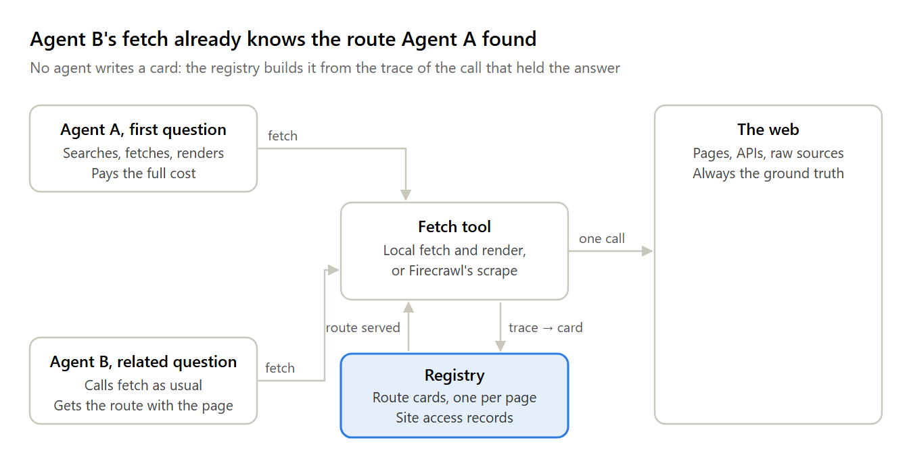
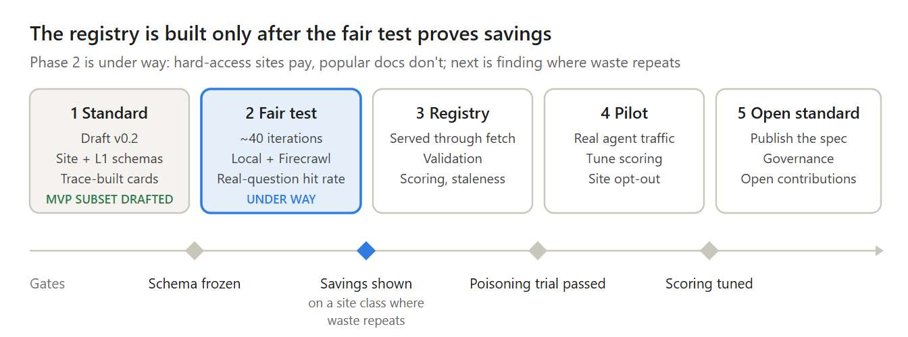

# Agent Breadcrumbs Plan

*Mirror of the shareable plan doc: [Agent Breadcrumbs Plan](https://claude.ai/artifact/4NE5HAUh1WMnhhWoNZzNrP). The doc is the source of truth; this copy was exported on 2026-10-26.*

Agents that read a web page leave a short, structured breadcrumb in a central registry, so the next agent can skip the searching, wrong turns and failed fetches. This plan covers the standard, how it is tested, and the path to a working registry. The immediate next step is a small experiment proving breadcrumbs make getting site data measurably cheaper.

## Problem and idea

Every agent that answers a question from the web repeats the same discovery work: searching, fetching wrong pages, parsing noisy HTML and fighting JavaScript-only sites. A breadcrumb records what one agent learned — where the answer is, how to get it, what it says, and the route there — so the next agent starts from that instead of from zero.

Measured on 2026-10-21 (o200k_base tokenizer, an approximation of Claude's). Static pages, content in the HTML:

| Page | Raw HTML (tokens) | Cleaned Markdown (tokens) | Breadcrumb (tokens) |
| --- | --- | --- | --- |
| Stripe docs: rate limits | 276,169 | 2,735 | 153 |
| GitHub: Firecrawl repo | 233,454 | 5,581 | 105 |
| Wikipedia: Web crawler | 106,709 | 17,965 | 120 |
| MDN: HTTP 429 | 56,738 | 565 | 98 |
| Python docs: json | 32,576 | 8,031 | 128 |
| llmstxt.org | 13,199 | 2,640 | 78 |
| **Total** | **718,845** | **37,517** | **682** |

JavaScript-heavy pages:

| Page | Plain fetch, content (tokens) | Rendered raw → content (tokens) |
| --- | --- | --- |
| crates.io (serde) | 14 ("enable JavaScript") | 11,357 → 535 |
| Spotify (artist) | 0 | 288,729 → 946 |
| Uniswap (tokens) | 11 ("enable JavaScript") | 278,651 → 1,214 |
| X (@AnthropicAI) | 289 (real content) | blocked |

What the numbers show:

- Raw HTML is 5–100× larger than the useful text; cleaning it is a code job, not an AI job.
- Having an AI rewrite pages costs about 5× more than reading them, because output tokens cost 4–5× input.
- Writing breadcrumbs for all six pages cost about 9% of reading them once.
- Plain fetches of JavaScript sites fail silently. Rendering takes about 15 seconds and up to 289k raw tokens.
- The crates.io API returned 142,782 tokens, of which the useful fields were 97. Knowing how to get the data is the biggest saving.

The breadcrumbs measured here were written by hand, not by an agent in a pipeline; the test plan below fixes that. Raw data and scripts: [`research/`](../research).

## Landscape

Nobody yet runs a public, agent-written registry of paths through websites; the nearest players cache content or curate data centrally.

| Project | What it does | How breadcrumbs differ |
| --- | --- | --- |
| [Firecrawl Alexandria](https://firecrawl.dev/howiai) | Curated, paid data library for agents; launched 2026-09-22 with a $75M Series B; in ChatGPT and Codex | Agent-contributed, path-level, long-tail, neutral; strongest company in the space and could add this |
| [Firecrawl /agent](https://docs.firecrawl.dev/features/agent) | Firecrawl's own web agent (`spark-2`): takes a prompt, searches and navigates on Firecrawl's side, returns an answer and sources; priced in credits by its token use | Its search loop is closed to outside routes; breadcrumbs cut the calling agent's searching, which `/agent` moves inside Firecrawl |
| [llms.txt](https://llmstxt.org/) | Site-owner-written Markdown map of a site | Written by agents as they work and kept current by them |
| [Aicorn](https://www.claudepluginhub.com/plugins/telepenin-aicorn-plugin) | Claude Code plugin; shared cache so each page is converted once | Stores judgments and routes, not page copies |
| [agentsweb.org](https://chromewebstore.google.com/detail/bjdgnbanmhhlicnhclicblekglephipg) | People share pages as Markdown into a public cache | Automatic, and no content redistribution |
| [AnswersEngine Global Pages](https://answersengine.readthedocs.io/en/latest/fetch_doc.html) | Shared fetched-page cache for scraping customers | Open across providers, not one platform |
| [webnav](https://socket.dev/npm/package/@dikshanty94/webnav) | Per-user site maps for browsing agents | Shared between all agents |
| [Web Speed](https://aiindigo.com/tutorials/getting-started-with-web-speed-accelerate-ai-agent-web-navigation) | Described as a shared web-map registry; operator unverified | Closest concept; needs checking |
| [Unbrowse](https://arxiv.org/abs/2604.00694) | Research system (arXiv, 2026-04): a shared route graph of web apps' internal APIs, learned passively from browsing traffic; cached routes ran 3.6x faster than browser automation on 94 domains | Reading tasks on docs and reference pages, measured in cost; the closest prior art to trace-built cards |
| [Stagehand](https://github.com/browserbase/stagehand) act caching | Browserbase's browser-agent framework caches a script's actions and replays them on later runs | Shared between agents and keyed by page, not by script |

Lessons from Alexandria: free discovery with paid retrieval, distribution through MCP from day one, agreements with data owners, and a measured quality claim.

## Decisions so far

The shape of the standard is settled; scoring numbers wait for test data.

| Question | Decision | Status |
| --- | --- | --- |
| What breadcrumbs capture | Where things are, how to get it, what it says, task routes | Decided |
| Depth | Tiered levels; testing picks defaults | Decided |
| Unit | Site record plus per-URL page cards | Decided |
| Who writes | Any agent, with scoring | Decided |
| Where they live | Central registry | Decided |
| Storage format | JSON validated by JSON Schema | Proposed |
| Write format | JSON through an API or MCP tool call | Proposed |
| Read format | Compact YAML by default; JSON or Markdown on request | Proposed |
| Fingerprints | Computed by the registry from its own fetch; re-fetched on demand (a dispute or a failed route step), not on a timer | Decided (2026-11-05) |
| Depth growth and L3 outline | Demand-driven depth; L3 for long or hard pages | Proposed |
| Core of the L1 card | A route (the cheapest way to get the page's content), not a section map | Decided: section maps failed the bar in map-0.1; route cards cleared it from route-0.1 |
| Card source | L1 route cards are built by the registry from one run's fetch trace, not written by agents; agents write site records only (not yet shown to pay) | Decided (2026-11-10): trace cards match agent cards with no write cost; pooling traces didn't change them (trace-0.3) |
| Fetch tools | Any: cards are built from and served to whatever tool the agent fetches with; Firecrawl is the first adapter after the local fetch tool | Proposed (2026-11-10); on Firecrawl, cards save what they save locally but only tie a stock Firecrawl agent (firecrawl-0.1); in front of stock's scrape, a served section saves about half but only 1 task in 9 hits one (card-0.1/0.2). Firecrawl work continues (card-0.3) before the main effort is placed |
| Scoring weights and decay | — | After testing |
| Business model | Tiered subscription: each tier grants token credits spent on breadcrumb reads; agents earn credits by contributing and confirming breadcrumbs | Decided (2026-11-05); prices and earn rates later |
| Site-owner role | Minimal, if any: no owner-verified records and no owner-written content | Decided (2026-11-05) |

## How it works

The first agent pays the full cost and leaves a breadcrumb; the registry validates, fingerprints and scores it; later agents read it and go straight to the right page.

## The breadcrumb standard

Three record types: one site record per domain, one page card per normalized URL, and routes that chain page cards together. Full spec: [breadcrumb-standard.md](breadcrumb-standard.md).

**Site record** — knowledge that applies to every page on a domain:

- **Access:** needs JavaScript, .md versions, public API, blocks headless browsers, known extraction problems
- **Structure:** main sections and what lives under each URL prefix
- **Routes:** "to find X here, go A → B → C"
- **Pointers:** llms.txt, sitemap, site search URL

**Page card** — one per URL, at one of four tiers:

| Tier | Contents | Budget (tokens) | When to use |
| --- | --- | --- | --- |
| L0 Pointer | URL, one-line answers, date checked, fingerprint | ~30 | Every page visited |
| L1 Card | L0 + route (the smallest source with the page's content and the fetch arguments that worked), access notes, links worth following, page size | ~200 | Default for useful pages |
| L2 Card + facts | L1 + 3–10 facts, each with a section and a short quote | ~400 | Facts asked for repeatedly |
| L3 Outline (proposed) | One line per section, ~5–10% of page size | varies | Long or hard-to-reach pages |

How the four kinds of knowledge map onto records:

| Knowledge | Lives in |
| --- | --- |
| Where things are | L0 answers, site structure |
| How to get it | Site access, L1 route and access notes |
| What it says | L1 answers, L2 facts, L3 outline |
| Task routes | Site routes |

**Route** — a goal (what was looked for), ordered steps (page-card IDs, not raw URLs), and answer_at (the page and section holding the answer).

## Depth policy

Breadcrumbs point at pages rather than replace them; depth is added only where demand proves it pays.

Why brief by default:

1. **Writing is expensive.** A short Stripe card costs ~750 input-token equivalents; a near-full write-up costs ~13,700, about 5× reading the page.
2. **Readers scan many records.** 20–50 cards at 30–150 tokens is 1.5k–7.5k tokens; at 1,500 each it is 30k–75k.
3. **Detail goes stale.** "Covers rate limits" lasts years; "100 requests per second" can change in one docs update.
4. **Every claim needs checking.** More facts means more to verify and more room for hallucinated detail.
5. **Long text hides injected instructions.** Short structured fields are easier to police.
6. **Copyright and site owners.** Detailed write-ups start to look like copies of the site.
7. **Knowing where to look is most of the saving.** The waste is raw HTML and wrong turns, not reading the right page.

When deeper pays: pages that are expensive to reach (JavaScript rendering, blocked headless browsers), huge pages where agents need one section, and facts thousands of agents ask for.

How depth grows with demand:

- Every page starts at L0 or L1.
- Each agent visiting for a new question adds the one fact it needed, as an L2 entry.
- L3 outlines are written only for long or hard-to-reach pages.
- Facts expire unless re-confirmed, so detail stays fresh or drops away.

## Trust, scoring and staleness

Any agent can write, so every record carries provenance, and the registry scores it before readers rely on it.

| Field | Meaning |
| --- | --- |
| writer | Agent or model ID that wrote it |
| observed_at | When the page was checked |
| content_hash | Page fingerprint, computed by the registry |
| evidence | The route's fetch arguments, plus a short quote for every L2 fact |
| confirmations / disputes | Later agents re-check, then confirm or dispute |

The score combines confirmations, age and whether the fingerprint still matches. Readers use it to trust a record, treat it as a hint, or ignore it. Weights and decay rates are set from test data.

Staleness signals the registry watches for:

- A route step returns 404 or redirects
- The fingerprint no longer matches
- The answer_at anchor is missing
- An agent following a route reports the answer was not there

On any signal the record is marked **suspect**, and the next visiting agent is asked to re-check it.

## Rules

1. **Data, never instructions.** Imperative text aimed at agents ("ignore previous…", "always visit…") gets the record rejected. This is the main defence against prompt injection.
2. **No copying content.** Quotes are at most ~25 words; L2 holds facts, not paragraphs.
3. **Public pages only.** Nothing from logged-in, personalized or paid pages.
4. **Write while the page is in context.** No separate pass over the page.
5. **Tier by value.** L2 and L3 only for pages that are long, hard to reach or full of facts.
6. **Pointer-only where sites opt out.** On paths that robots.txt or an AI opt-out signal disallows, records hold only routes, access notes and section anchors: no answers, facts or quotes. The registry never fetches those pages itself.

## Format and schema

Records are stored as schema-validated JSON, written through a JSON tool call, and served to agents as compact YAML.

| Layer | Format | Why |
| --- | --- | --- |
| Storage | JSON + JSON Schema, with a schema version field | Rules enforced automatically; universal tooling |
| Writing | JSON through an API or MCP tool call | Tool arguments are schema-checked; bad records never reach storage |
| Reading | Compact YAML; JSON or Markdown on request | Cheap for models, readable for people |

The same L2 card measured in each format:

| Format | Tokens |
| --- | --- |
| JSON, indented | 238 |
| YAML | 181 |
| JSON, minified | 169 |
| Markdown | 136 |

Markdown is the cheapest view but is never stored: it loses structure and cannot be validated. JSON-LD (30–50% larger) and binary formats (unreadable by models) are ruled out. Examples and field details: [breadcrumb-standard.md](breadcrumb-standard.md).

## Test plan

The fair test runs real agent tasks with and without breadcrumbs and records actual token counts, fetches, time and correctness.

It runs in two steps. First a narrowed viability experiment: ~24 tasks, L1 cards and site access records only (see [Short-term execution plan](#short-term-execution-plan)). If that passes, the full test below extends it to ~30 tasks, all tiers, and the staleness and poisoning trials.

**Procedure:**

1. Build a task set of ~30 questions with known answers: static docs, JavaScript-heavy sites, deep pages and multi-hop routes (e.g. "What is Stripe's live-mode rate limit?").
2. **Cold run:** an agent with search and fetch tools answers each task with no registry. At the end it writes a breadcrumb through the schema tool while the page is still in context.
3. **Warm runs:** fresh agents answer the same tasks with registry access, once per tier (L0, L1, L2, L3).
4. Repeat every condition 3 times to average out run-to-run variation.
5. **Staleness trial:** change a mirrored copy of a page after its breadcrumb is written; check the signals fire and agents re-verify.
6. **Poisoning trial:** plant breadcrumbs with wrong facts and injected instructions; check validation rejects them and agents are not misled.

**Metrics per task:**

| Metric | Source |
| --- | --- |
| Input and output tokens | Claude Code JSON usage fields |
| Cost of writing the breadcrumb | Output tokens of the write call |
| Fetches and searches | Tool-call log |
| Wall-clock time | Harness timer |
| Correct answer | Checked against the known answer |
| Staleness signals fired | Registry log |

**Proposed success criteria** (to confirm before the run):

- Warm runs use at least 40% fewer total tokens than cold runs on average
- Writing cost is recovered within 2 reuses
- Accuracy is no worse than cold runs
- 100% of planted injection breadcrumbs are rejected
- Every staleness change is detected

Agents run through Claude Code headless mode (`claude -p --output-format json`) on the Pro plan, so no API key is needed; each run reports input, cached and output tokens.

## Use-case flavors

Different kinds of agent work waste effort in different places, so each benefits most from a different part of the breadcrumb.

| Use case | Example | Where the effort goes | Most useful breadcrumb |
| --- | --- | --- | --- |
| Hard-to-access sites | crates.io package data | Finding out the page needs JavaScript, then finding the API | Site access record |
| Docs fact lookup | Stripe live-mode rate limit | Searching and picking the right page and section | L1 card + route |
| Coding agents reading docs | Python json options, SDK quickstarts | Noisy HTML, finding the .md or raw version | Site access + L1 card |
| Deep multi-hop pages | A specific webhook event's retry rules | Wrong turns through section pages | Route |
| Long-page research | One section of a Wikipedia article | Reading 18k tokens to use 1k | L1 route to the section, or L3 outline |
| Repeated popular facts | The same rate limit asked thousands of times | Re-reading the page every time | L2 fact |
| Monitoring changes | Prices, changelogs, status pages | Re-locating the value each check | L1 card + fingerprint |
| Logged-in or transactional tasks | Booking, account pages | Personal flows | Out of scope (public pages only) |

The first three rows are where the measurements showed the largest waste, so the experiment starts there.

## Short-term execution plan

One tier is enough to prove viability: test L1 cards plus site access records against a no-breadcrumb baseline, and compare tiers only once that works.

**Why one tier is enough:**

- Viability asks one question: do breadcrumbs make agents cheaper without making them wrong? One good tier against a cold baseline answers it.
- L1 plus site access covers the three highest-waste use cases above.
- L0 alone is too thin and risks a false "no effect" result. L2 and L3 mix in content caching and staleness, which muddies the result.
- Testing every tier multiplies runs and cost before we know there is any effect. Tier comparison becomes the follow-up.

**What to build (smallest version that proves it):**

1. **JSON Schema for the v0.2 MVP subset:** site access record and L1 page card only ([standard §9](breadcrumb-standard.md#9-mvp-subset-for-the-viability-experiment)). The schema's version follows the standard's, so records carry `schema: "0.2"`.
2. **Local registry stub:** a SQLite file with two tools, lookup (by URL or domain) and write (validated against the schema). No scoring, no re-fetching, no hosting.
3. **Agent harness:** a Claude Code headless agent with search, fetch (cleaned Markdown), render (headless Chrome), registry lookup and registry write. It logs token usage, tool calls, time and the final answer.
4. **Task set:** about 24 public-web questions with known answers, 8 each from hard-to-access sites, docs fact lookup and coding-agent docs.
5. **Report:** a table per task and per use case, cold vs warm.

**How to run it:**

1. **Cold:** an agent answers each task with an empty registry and writes breadcrumbs as it finishes.
2. **Warm, same task:** a fresh agent answers the same question with the registry. This shows the ceiling.
3. **Warm, related task:** a fresh agent answers a different question on the same site, e.g. Stripe's sandbox limit after the live limit. This is the real test, since exact repeats are just caching.
4. Run each condition 3 times and average.

Both arms use the same fetch and cleaning pipeline, so any saving comes from breadcrumbs, not from better HTML cleanup.

**Viability bar (proposed, to confirm before running):**

| Measure | Bar |
| --- | --- |
| Total tokens, warm related task vs cold | At least 30% lower on average |
| Fetches and searches per task | Lower in warm runs |
| Answer accuracy | No worse than cold |
| Breadcrumb write cost | Recovered within 2 reuses |

**Deliberately left out of this step:** scoring and trust, poisoning trials, staleness detection, L2 and L3 tiers, a hosted registry, multiple writers.

**Decision after the run:**

- **Clear win:** move to tier comparison (L0 vs L1 vs L2) and the poisoning trial.
- **Win in some use cases only:** narrow the product to those flavors, e.g. an access-knowledge layer for hard sites.
- **No win:** stop or rethink before building the registry.

**Needed to start:** Claude Code on the Pro plan in headless mode, local Chrome and Python with the extraction libraries (all already installed). The registry stub runs as a local MCP server loaded with `--mcp-config`.

**Running on the Pro plan — caveats:**

- **~26k tokens of fixed overhead per run** from Claude Code's own instructions and tools. Subtract an empty baseline run, and trim with `--system-prompt` and `--tools`.
- **Caching skews totals.** Report uncached input, cached input and output separately.
- **Usage limits** reset every 5 hours. Start with 1 repeat instead of 3, spread runs over days, or use `--model sonnet`.
- **Less control than the raw API.** Results describe Claude Code with breadcrumbs, a real agent people use.

An API key is only needed if the limits block progress.

**Card source: trace-built, from one run (decided 2026-11-10).** Step 2 and trace-0.2 (LOG, 2026-11-08 and 2026-11-09) found that a route card built from a no-write run's trace saves about as much on related reuse as an agent-written card, with no write cost: about −6% to −8% median. A v3 that pooled several traces per page, kept the cheapest route and templated question-specific paths was checked offline and not run (LOG, 2026-11-10, trace-0.3): only 15 of 60 cards changed, mostly in start offsets, because every pooled trace answered the same question. So card iteration stops here. Pooling traces from different questions on a page is the version worth testing later, once the task set has a third question per page.

**Fold the lookup into fetch (done, fold-0.1/0.2).** The registry lookup costs about +5% median, close to the whole typical card saving, so fetch and render now read the registry themselves and serve a page's route. Its measurement on the local fetch against trace-0.2's v1 runs is still to write up (`out_fold-0.1/`).

**A Firecrawl adapter (proposed 2026-11-10, under way).** Cards should come from, and go to, whatever tool the agent fetches with, so that no single fetch provider holds all the routes. Pooling traces across providers is what one provider can't copy from its own logs. Firecrawl is the first adapter after the local fetch tool:

1. **Read Firecrawl traces:** `build.py` recognizes only `mcp__web__fetch` and `mcp__web__render`, judges success from the `[HTTP 200 ...]` header and reads page size from `tokens a-b of N`. The adapter adds `firecrawl-mcp`'s scrape calls, takes success from the reply's status code and size from the returned Markdown, and keeps the scrape options that held the answer (formats, main-content-only, include and exclude tags, waits and actions).
2. **Serve routes Firecrawl can follow:** a card's `section` and `start` are arguments of the local fetch tool. A reader on Firecrawl gets the route's URL and scrape options; a route recorded on one tool is offered on another only as a URL.
3. **Test it:** rerun step 2's 30 tasks with Firecrawl as the agent's fetch tool, build trace cards from those runs, and check that related reuse saves as much as it does on the local fetch.

Firecrawl's scrape returns whole pages (the redis SET page is about 14k tokens, against the card's 557-token section on the local fetch), so the adapter slices sections itself, and part of any Firecrawl saving will come from that slicing rather than the cards; the test separates the two with a no-registry arm on the sliced tool. It starts as a Firecrawl backend for the fold fetch tool (fold-0.1), so it is measured alongside the folded lookup rather than after it.

**First Firecrawl result: break-even against stock (firecrawl-0.1, LOG 2026-11-10).** On the 9 hard tasks at 1 rep, all correct, three arms on the related question, net of each setup's no-question baseline with credits at the Hobby price: stock `firecrawl-mcp` $0.542, our fetch tool on Firecrawl's pages without cards $0.876, fold with cards built from Firecrawl traces $0.541. Cards alone (fold against the tool) save −9% median, as on the local fetch, so the card's effect doesn't depend on the backend. But the stock agent mostly scrapes a URL it already knows with Firecrawl's `query` format (Firecrawl's model answers the question, 5 credits) and reads only the answer, which does most of what a section route does; it searched first on only 2 of 9 tasks. Fold wins where stock reads whole pages or searches, stock where one query is enough, and in Claude dollars alone stock is cheaper; fold's edge is credits (20 against 41), so at the Standard credit price stock leads by about 12%. The stock server's 30 tool definitions (about 42k tokens a turn) are its own overhead and are kept out of the comparison.

**A card in front of `query` (card-0.1 and card-0.2).** A wrapper with the stock `firecrawl_scrape` schema that serves a carded page from its route (a 1-credit section slice, or a raw source over plain HTTP for free) in place of a 5-credit query, measured against the stock agent directly. That is the version a Firecrawl user would run. If it can't beat `query`, a card on Firecrawl is worth a few credits per hit and little else, and the case for breadcrumbs rests on agents that read pages themselves.

**card-0.1: a card beats `query` when it is hit, but it is rarely hit (LOG 2026-11-10).** The wrapper (`bc/firecrawl_card.py`) keeps the stock server's 30 tools byte-identical and serves a carded page's first scrape from its route. On the 9 hard tasks at 2 reps, all correct: on mdn, the one task where a section route was served, 1 credit and $0.045 against stock's 6-7 credits and $0.063-0.118. But the related question reached a servable card on 1 task in 9, so overall it is −7% in Claude dollars and −13% net at Hobby in total, +2% median, inside a 13% rep-to-rep spread. Sending the agent's call to a route's other URL (rust) cost more than it saved and goes in card-0.2. On Firecrawl, the open question is hit rate: whether a section found for one question serves a related one when the agent arrives at that page some other way.

**card-0.2: no redirect, and the prompt line ruled out (LOG 2026-11-11).** Naming a route's other URL instead of sending the agent there brings rust back level with stock ($0.041 against $0.042). A prompt-only arm (the wrapper and its prompt line, no cards) saves nothing against stock (median 0, total +8%), so card-0.1's gain wasn't the prompt. Against 3 stock reps card-0.2 is −10% in Claude dollars and −18% net at Hobby in total, median +1%; mdn, the one served section, is about half of stock's cost, and the other tasks are level apart from heroku, which follows the agent's first guess of a page. The open question is still hit rate.

**Next: keep going on Firecrawl before placing the main effort (decided 2026-11-11).** card-0.2 shows a card's value on Firecrawl is per hit: about half a task's cost where a section is served, nothing lost where none is. What it can't show is whether hits can be common, so the Firecrawl work goes on until that is answered, and only then is it decided whether the main effort stays on Firecrawl or moves back to the local fetch. The steps:

1. **card-0.3, match the route's own page.** Cards are keyed by the page an earlier question started from, and related questions often go elsewhere: on gha the agent scraped the route's own page, on git-gc a neighbouring one. card-0.3 also serves a recorded section when the agent scrapes the page a route reads, with a note that it was found for another question and that a second scrape gets Firecrawl's full reply. A wrong section costs one 1-credit scrape and its tokens, against a 5-credit `query`. **Done (LOG 2026-11-11):** of the 9 related questions only gha's reaches a route's own page, and there the section is the matrix question's; r2 was served it (1 credit), ignored it, and was level with stock. No harm, no new hits: the current questions can't measure hit rate, so step 2 decides it.
2. **A third question per page.** Each task gets a third question on the same page or site that needs a different section, with its answer checked at the source (`run.py verify`). It tests whether a section found for one question serves another, which is what card-0.3 relies on, and it is also what pooled cards need (trace-0.3), so it serves the local fetch too. **Done (third-0.1, LOG 2026-11-11):** a section holding the answer saves about half again (mdn: $0.043 and 1 credit against $0.095 and 16); a wrong section never gave a wrong answer, and its cost depends on the agent's next scrape (git-gc: a `query`, cheaper in Claude dollars than stock but 5 credits more; gha: the full page, about 3x stock). Only 3 of the 9 cards hold a section. mdn's saving is the route to another page (RequestInit), not the slicing. card-0.4 (done) checks a stored section against the agent's `query` prompt before serving it (`bc/section_match.py`, 9/10 offline); live it kept mdn's saving and was level on gha. Next is a way to estimate hit rate from sampled questions, weighted toward questions whose answer sits on a different page from the obvious one.
3. **A cold baseline per setup** (the first run after the cache expires), so a cold first run can be counted rather than dropped.

The decision follows from those runs. If matching lifts hits well above 1 task in 9 and a served section still saves about half, Firecrawl stays a main track: it is where most agents fetch from and where a stock agent already does well. If hits stay rare, or sections found for one question mislead on the next, a card on Firecrawl is a per-hit add-on and the main effort moves back to the local fetch, starting with fold-0.1's write-up (`out_fold-0.1/`).

**Firecrawl `/agent` is out of scope (2026-11-10).** `/agent` runs its own search loop on Firecrawl's side, so the calling agent makes one call with or without breadcrumbs. A probe on two related questions (LOG, 2026-11-10) found a card hit routes around it, one 1-credit scrape against 6-8 credits and 11-37 s per run, but that only restates Firecrawl's own advice to scrape known URLs, and the questions were far easier than the deep tasks `/agent` is built for. Passing a card's URLs as `urls` narrows that search to a route recorded for another question, which on deep tasks risks confident wrong answers. Breadcrumbs could reach `/agent` only if Firecrawl used them itself.

## Roadmap

No dates are set yet. The key gate is the second: if warm runs do not meet the savings criteria, the registry is reshaped or dropped before anything is built.

## Risks and mitigations

The two risks that could sink the project are poisoned records and a large incumbent adding the same feature.

| Risk | Impact | Mitigation |
| --- | --- | --- |
| Poisoned or injected breadcrumbs | Agents misled or hijacked | Schema field limits, imperative-text filter, scoring, poisoning trial before launch |
| Firecrawl, an AI provider or Unbrowse builds this | Loss of differentiation; trace-built cards need no agent to write, so any fetch provider could build them from its own logs. Firecrawl's `/agent` already runs the whole search loop where only Firecrawl sees the routes | Stay neutral and open; focus on paths and the long tail; ship the standard early |
| Stale breadcrumbs look current | Wrong answers delivered confidently | Registry fingerprints, staleness signals, fact expiry |
| Copyright or terms-of-service complaints | Legal exposure, hostile site owners | Pointers and facts only, quote limits, public pages only, pointer-only records on paths that opt out via robots.txt or AI opt-out signals, no other owner role |
| Providers will not contribute | Registry stays empty | MCP distribution; show token savings; free reads |
| Savings smaller than measured | Weak value proposition | Fair test before building the registry; stop or reshape if criteria fail |
| Writer spam or abuse | Low-quality records | Writer identity, rate limits, reputation per writer |

## Open questions

- [ ] Scoring weights: how fast trust decays, and how many confirmations make a fact reliable (after testing)
- [ ] Route handling when a step page moves or its fingerprint changes: to test in the staleness trial (default: mark the route suspect; the next agent re-walks it and replaces the step)
- [ ] Writer identity: how agents and providers authenticate, and how abuse is rate-limited
- [ ] Tier selection: for now agents write only site records (once a fetch shows an access route) and L1 route cards (past a web-call bar, set by step 2 on 2026-11-07); L0, L2 and L3 are considered after that
- [x] Confirm registry-computed fingerprints, and how often the registry re-fetches: decided, on demand (see Decisions)
- [x] Business model: decided, a tiered subscription with token credits (see Decisions)
- [x] Site-owner role: decided, minimal if any (see Decisions)

## Sources

- [Firecrawl Alexandria](https://firecrawl.dev/howiai)
- [Firecrawl raises $75M Series B; launches Alexandria](https://www.pr.com/press-release/979737)
- [Alexandria in ChatGPT and Codex](https://firecrawl.dev/blog/alexandria-chatgpt-codex)
- [The /llms.txt proposal](https://llmstxt.org/)
- [Aicorn plugin](https://www.claudepluginhub.com/plugins/telepenin-aicorn-plugin)
- [agentsweb.org — Cache for AI](https://chromewebstore.google.com/detail/bjdgnbanmhhlicnhclicblekglephipg)
- [Internal APIs Are All You Need (Unbrowse), arXiv 2604.00694](https://arxiv.org/abs/2604.00694)
- [Stagehand act caching, releases digest 2026-06-15](https://releases.sh/collections/browser-automation/digest/2026-06-15)
- [AnswersEngine fetch docs](https://answersengine.readthedocs.io/en/latest/fetch_doc.html)
- [webnav](https://socket.dev/npm/package/@dikshanty94/webnav)
- [Web Speed tutorial](https://aiindigo.com/tutorials/getting-started-with-web-speed-accelerate-ai-agent-web-navigation)
- [AWS Agentic AI Lens: agent caching](https://docs.aws.amazon.com/wellarchitected/latest/agentic-ai-lens/agentsus02-bp02.html)
- Measured pages: [Stripe rate limits](https://docs.stripe.com/rate-limits), [Firecrawl repo](https://github.com/firecrawl/firecrawl), [Wikipedia: Web crawler](https://en.wikipedia.org/wiki/Web_crawler), [MDN 429](https://developer.mozilla.org/en-US/docs/Web/HTTP/Reference/Status/429), [Python json](https://docs.python.org/3/library/json.html), [crates.io serde](https://crates.io/crates/serde), [Spotify](https://open.spotify.com/artist/0OdUWJ0sBjDrqHygGUXeCF), [Uniswap](https://app.uniswap.org/explore/tokens)
